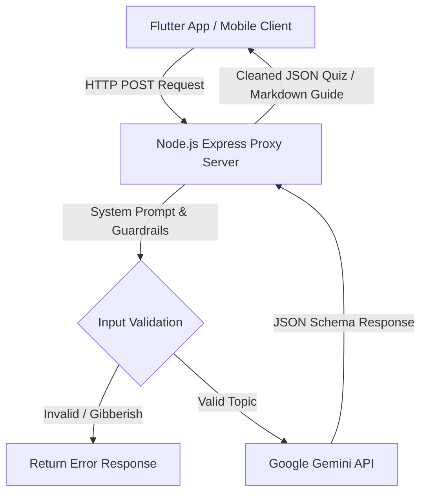

<div align="center">

  # 🎓 QuizYu — AI Smart Quiz & Learning Platform
  
  **An intelligent, AI-powered mobile quiz and personalized learning app built with Flutter, Node.js, and Google Gemini API.**

  [](https://flutter.dev)
  [](https://dart.dev)
  [](https://nodejs.org)
  [](https://expressjs.com)
  [](https://ai.google.dev)
  [](LICENSE)

</div>

---

## 📌 Overview

**QuizYu** (Backend: *PrepMaster AI*) is a full-stack mobile application that transforms any learning topic into interactive multiple-choice quizzes and personalized study guides in real time.

Whether you're studying **Flutter**, **Data Structures**, **World History**, or **Quantum Physics**, QuizYu uses Large Language Models (**Google Gemini API**) to construct structured questions with options, hints, and explanations, while evaluating user weakness to generate custom Markdown study materials.

---

## ✨ Key Features

- 🤖 **AI Dynamic Quiz Generation**: Generates high-quality multiple-choice questions for any topic with customizable difficulty levels (*Easy*, *Medium*, *Hard*) and question counts (1–30 questions).
- 🧠 **Natural Language Prompt Extraction**: Automatically detects question counts directly from prompt text (e.g., `"20 soal pseudocode"`).
- 🛡️ **Validation & Anti-Gibberish Guardrails**: Filters out empty queries and random keyboard mashes (e.g., `"asdfgh"`) with friendly AI feedback.
- ⏱️ **Interactive Quiz Experience**: Includes timed question sessions, an AI-powered **Hint Engine** to assist without revealing answers, and instant score calculation.
- 📚 **Personalized AI Study Guide**: Evaluates missed questions at the end of each session and generates a custom **Markdown Study Guide** complete with an interactive **Smart Glossary**.
- 📊 **Comprehensive Dashboard**: Displays accuracy metrics, completion times, and a detailed breakdown of correct vs. incorrect answers.
- ⚡ **Multi-Model Fallback & Resilience**: Built-in automatic fallback strategy across Gemini model candidates (`gemini-3.5-flash`, `gemini-flash-latest`, `gemini-2.0-flash-lite`, etc.) alongside offline detection and graceful HTTP 429 (Rate Limit) handling.

---

## 🛠️ Tech Stack & Architecture

### **Client (Mobile App)**
- **Framework**: [Flutter](https://flutter.dev) (Dart 3)
- **State Management**: [Flutter Riverpod 2.x](https://riverpod.dev)
- **HTTP Client**: [Dio](https://pub.dev/packages/dio) (with custom interceptors & error parsers)
- **UI & Markdown**: `google_fonts`, `flutter_markdown`

### **Server (Backend Proxy)**
- **Runtime**: [Node.js](https://nodejs.org) + [Express.js](https://expressjs.com)
- **AI SDK**: `@google/generative-ai` (Google Gemini API)
- **Middleware**: `cors`, `dotenv`

---

## 🏗️ System Architecture



> **Why a Backend Proxy?**
> The Node.js proxy server keeps your **Gemini API Key secure** (preventing reverse-engineering from mobile APKs), enforces strict **JSON Schema Output**, handles model retries, and validates inputs before hitting the LLM.

---

## 📁 Project Structure

```text
quizyu/
├── backend/                  # Node.js Express Proxy Server
│   ├── .env.example          # Environment variables template
│   ├── index.js              # Server logic & Gemini API integration
│   └── package.json          # Node dependencies
├── lib/                      # Flutter Frontend Codebase
│   ├── models/               # Data models (QuizQuestion, QuizSession, QuizSettings)
│   ├── providers/            # Riverpod Notifiers (QuizNotifier, SettingsNotifier)
│   ├── services/             # API Service (Dio HTTP Client & error handling)
│   ├── theme/                # Application Theme & Styling
│   ├── views/                # Screen UI Components
│   │   ├── widgets/          # Reusable UI Widgets & Sheets
│   │   ├── dashboard_screen.dart
│   │   ├── home_screen.dart
│   │   ├── loading_screen.dart
│   │   ├── main_navigation_wrapper.dart
│   │   ├── quiz_screen.dart
│   │   └── study_guide_screen.dart
│   └── main.dart             # App Entry Point
└── pubspec.yaml              # Flutter Dependencies & Assets
```

---

## 🚀 Getting Started

### Prerequisites

Ensure you have the following installed on your machine:
- [Flutter SDK](https://docs.flutter.dev/get-started/install) (v3.19.0 or higher)
- [Node.js](https://nodejs.org/) (v18.x or higher)
- A **Google Gemini API Key** (Get one for free at [Google AI Studio](https://aistudio.google.com/))

---

### 1️⃣ Backend Setup

1. Navigate to the `backend` directory:
   ```bash
   cd backend
   ```

2. Install Node.js dependencies:
   ```bash
   npm install
   ```

3. Create a `.env` file in the `backend/` directory and add your Gemini API key:
   ```env
   PORT=3000
   GEMINI_API_KEY=your_actual_gemini_api_key_here
   ```

4. Start the proxy server:
   ```bash
   npm start
   ```
   *The server will run on `http://localhost:3000`.*

---

### 2️⃣ Mobile Client Setup

1. Open a new terminal tab and return to the project root:
   ```bash
   cd ..
   ```

2. Fetch Flutter dependencies:
   ```bash
   flutter pub get
   ```

3. Run the app on your preferred emulator or device:
   ```bash
   # Run on Chrome / Web
   flutter run -d chrome

   # Run on Android Emulator
   flutter run
   ```

> 💡 **Note for Android Emulators**: The app automatically uses `http://10.0.2.2:3000` to communicate with the local Node.js backend when running on an Android emulator.

---

## 🛡️ Error Handling & Resiliency

- **Offline Detection**: Automatically catches connection timeouts and socket exceptions, notifying users with a floating SnackBar.
- **Quota Exceeded (HTTP 429)**: Handles Gemini API rate limits with friendly user warnings and automated retry suggestions.
- **Multi-Model Candidate Pool**: If a specific model is busy or throttled, the server seamlessly falls back to alternative model endpoints (`gemini-3.5-flash` ➔ `gemini-flash-latest` ➔ `gemini-2.0-flash-lite`).

---

## 📄 License

Distributed under the **MIT License**. See `LICENSE` for more information.

---

## 👤 Author

Developed with ❤️ by **[Your Name]**
- GitHub: [@yourusername](https://github.com/yourusername)
- LinkedIn: [Your Profile](https://linkedin.com/in/yourprofile)

---

<div align="center">
  <sub>Built with Flutter, Node.js, and Google Gemini API. Star ⭐ this repository if you found it useful!</sub>
</div>
